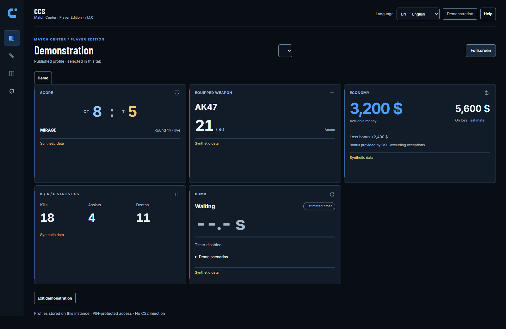
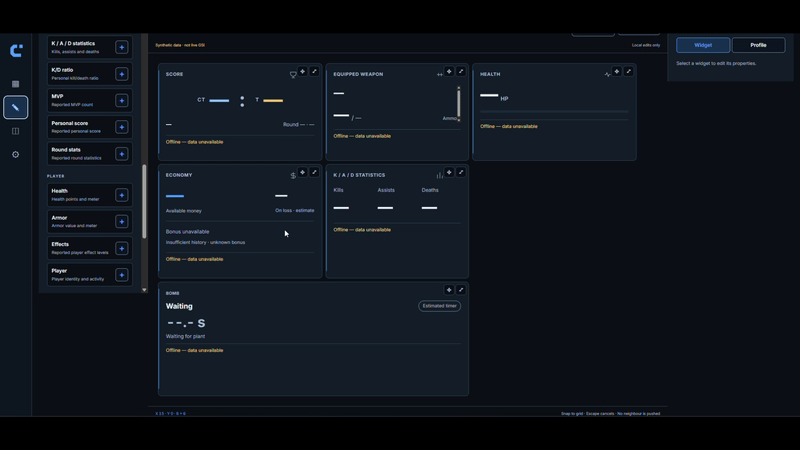

# CS2 Companion Studio

**Your match. Your second screen.**

Personal CS2 dashboard powered by Game State Integration. Keep useful match information on another screen and build your own layout in a separate visual Studio.

An independent project developed with substantial **ChatGPT/Codex (OpenAI)** assistance. [AI disclosure](AI_DISCLOSURE.md).

**[Download v1.1.0](https://github.com/Shibxtshi/cs2-companion-studio/releases/tag/v1.1.0)** · **[Windows setup](docs/user/installation.md)** · **[Documentation](docs/README.md)** · [Français](docs/README.fr.md)

## See CCS in action

*A real V1.1.0 Dashboard capture using the built-in demonstration. The values are synthetic, not a live CS2 match.*

### Build your layout

Move and resize widgets on the canvas, then adjust their presentation and appearance in the inspector. Local drafts stay separate from your published Dashboard.

Watch the Customization Studio — 14-second recording

*Maintainer-provided recording with offline values. Expand to play; collapse to hide the animation.*

## Make it yours

| Feature | What you can do |
|---|---|
| **Visual Studio** | Add, move, resize, duplicate and style widgets; undo/redo and preview your changes. |
| **29 widget types** | Choose match, weapon, economy, player, bomb, statistics and connection information. |
| **3 presentations** | Pick Standard, Compact or Minimal per widget. Solid, Glass and Outline surfaces are separate choices. |
| **10 themes** | Use Tactical Blue, Arctic White and eight more palettes, with individual color overrides. |
| **Drafts and profiles** | Keep persistent local drafts; **Save and apply** explicitly publishes and synchronizes a profile. Each tab selects its own profile. |
| **Responsive layouts** | View your Dashboard in a browser on a PC, tablet or phone. LAN setup is required for other devices. |
| **7 languages** | English, French, Russian, Polish, Ukrainian, Czech and Romanian. |
| **CS2 GSI** | Display the game data CS2 makes available, with clear missing-data and estimate states. |

The five additional translations use machine translation and AI-assisted review; native-speaker review has not been completed. See the [V1.1.0 notes](docs/releases/release-notes-1.1.0.md).

## Start on Windows

1. **[Download the official source ZIP](https://github.com/Shibxtshi/cs2-companion-studio/releases/download/v1.1.0/CS2-Companion-Studio-v1.1.0.zip)** from the release. Its SHA-256 file is attached to the same release.
2. Extract the **entire ZIP** into a writable folder. Do not launch the installer from inside the archive.
3. Install/start **Docker Desktop with Compose v2**, and make sure **Steam and CS2 are installed**. The guided installer uses Windows PowerShell 5.1 or PowerShell 7; it does not require Python.
4. Run **`INSTALLER_WINDOWS.cmd`** and follow the prompts for language and the detected CS2 folder. Keep your installation PIN private.
5. Open **`http://localhost:8080`** (or your configured port) and connect with that PIN. You can also explore the synthetic demonstration without a running game.

A new Dashboard starts **empty**. Open **Customization Studio**, add widgets and choose **Save and apply**. Restart CS2 after installing/changing its GSI configuration. For detailed prerequisites, permissions and troubleshooting, follow the [Windows installation guide](docs/user/installation.md) and [first-use walkthrough](docs/user/first-use.md).

The release includes source, the Windows installer, Dockerfile and Compose. **No prebuilt Docker image is published.** Preserve `.env`, `data/` and your recovery backups when maintaining an existing installation; follow the [maintenance guide](docs/user/maintenance.md).

## Find your way

- **Get started:** [Installation](docs/user/installation.md) · [First use](docs/user/first-use.md) · [Studio](docs/user/studio.md).
- **Customize:** [Widgets](docs/user/widgets.md) · [Themes](docs/user/themes.md) · [Trusted LAN access](docs/user/network.md).
- **Get help:** [Support](SUPPORT.md) · [Troubleshooting](docs/user/maintenance.md) · [Backups and recovery](docs/user/backup.md). Report security issues through [SECURITY.md](SECURITY.md), not a public bug report.
- **Contribute:** [Contributing](CONTRIBUTING.md) · [Translations](docs/contributing/translations.md) · [Developer documentation](docs/development/README.md).
- **Follow the project:** [Changelog](CHANGELOG.md) · [Roadmap](docs/ROADMAP.md) · [Code of conduct](CODE_OF_CONDUCT.md).

Streamer Mode and Overlay Studio are future work, not features of V1.1.0.

## Security, license and transparency

**GSI, not game injection.** CCS receives Game State Integration messages. It does not read game memory, inject code or provide an injected in-game overlay. Some information is unavailable; economy forecasts and optional bomb timing are estimates. The estimated bomb timer is **disabled by default**.

**Local first.** Localhost is the default. Other devices require explicit setup on a **trusted private LAN**. HTTP/WebSocket traffic is **not encrypted**, and the PIN does **not** encrypt it. Do not expose CCS directly to the Internet or forward its port from a router. One shared PIN is instance access, not a multi-user account system. Never share credentials, generated GSI files, personal profiles or raw logs. Read the [security policy](SECURITY.md).

**License.** CCS is **source-available, not OSI-approved open source**, under the [Community No-Resale License v1.0](LICENSE). Read its terms before redistributing or offering services; the [French translation](docs/legal/LICENSE.fr.md) is informative and English is authoritative. License adoption was integrated through an expressly authorized merge; no legal certification is claimed. Third-party components retain their own terms, including the [local fonts and notices](static/fonts/README.md). Contributors retain their rights and must grant the permissions described in [CONTRIBUTING.md](CONTRIBUTING.md).

**Independent and AI-assisted.** This is a solo-maintained personal project developed with substantial ChatGPT/Codex assistance and iterative maintainer testing. AI-assisted work can contain errors; no independent security certification is claimed. CCS is **not affiliated with or endorsed by Valve, Counter-Strike 2, FACEIT or OpenAI**. Compatibility or permission on competitive platforms is not guaranteed: check their applicable rules. See [AI disclosure](AI_DISCLOSURE.md) and [usage limitations](docs/guides/usage-and-affiliation.md).
