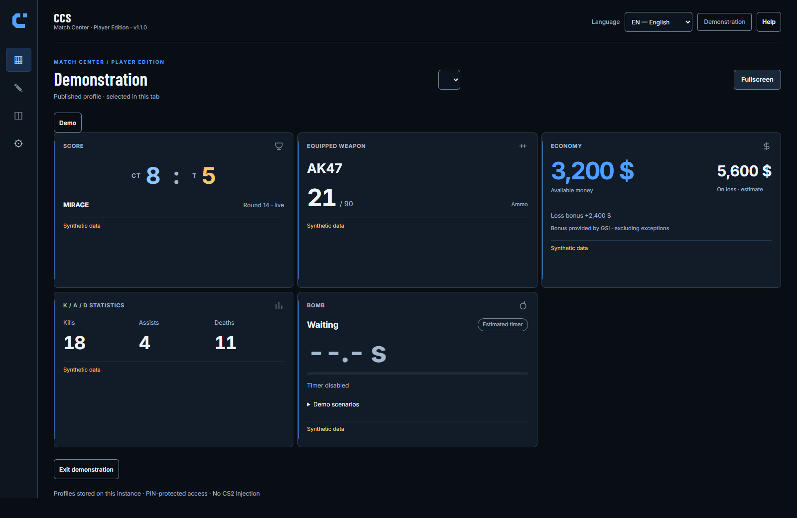
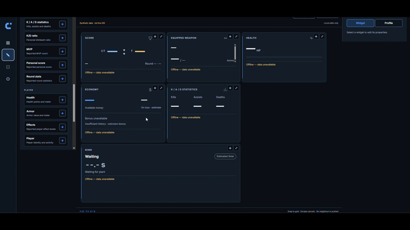

# Documentation CCS

[English](README.md) · [Présentation du projet](../README.md)

**Votre partie. Votre deuxième écran.** CCS est un Dashboard personnel pour Counter-Strike 2, alimenté par les données Game State Integration du jeu. Composez votre affichage dans le Customization Studio, puis consultez-le sur PC, tablette ou téléphone.

**[Télécharger V1.1.0](https://github.com/Shibxtshi/cs2-companion-studio/releases/tag/v1.1.0)** · **[Installation Windows](user/installation.fr.md)** · [Premier démarrage](user/first-use.fr.md)

*Capture réelle de la démonstration intégrée, pas d’une partie CS2 réelle.*

Voir le Customization Studio en action — 14 secondes

*Enregistrement fourni par le mainteneur, avec des valeurs hors ligne. Dépliez pour voir l’animation.*

CCS propose **29 types de widgets**, **trois présentations**, **dix thèmes** et **sept langues**. Le Studio conserve vos changements dans un brouillon local ; **Enregistrer et appliquer** publie explicitement le profil. Les cinq langues supplémentaires n’ont pas encore reçu de relecture native. Consultez la [présentation anglaise](../README.md) et les [notes V1.1.0](releases/release-notes-1.1.0.md).

Projet personnel indépendant développé avec une aide importante de ChatGPT/Codex (OpenAI), sans affiliation Valve/FACEIT/OpenAI, sans audit de sécurité indépendant ni approbation compétitive. La [licence Community No-Resale v1.0](../LICENSE) est propriétaire à code accessible, et non open source au sens OSI. Consultez sa [traduction française informative](legal/LICENSE.fr.md) ; seul le texte anglais fait foi. Les composants tiers conservent leurs propres licences.

## Choisir son parcours

- [Utilisateur — guides français](user/README.fr.md) : installation, premier widget, Dashboard, Studio, 29 widgets, dix thèmes, LAN, sauvegardes et dépannage.
- [Contributeur (anglais)](contributing/README.md) : issues, PR, tests ciblés, conventions, droits et assistance IA.
- [Traductions (anglais)](contributing/translations.md) : catalogues JSON en sept langues, paramètres et ajout d’une langue.
- [Développeur (anglais)](development/README.md) : architecture, modules, flux, contrats, stockage, publication et tests.

Les pages utilisateur suivent la convention `page.md` / `page.fr.md`, avec un lien de langue. Les références techniques sont maintenues en anglais pour éviter deux descriptions contradictoires.

## Exploitation et publication

- [Sécurité importante et récupération](user/backup.fr.md), [LAN non chiffré](user/network.fr.md), [maintenance](user/maintenance.fr.md).
- [Support (anglais)](../SUPPORT.md) et [signalement privé de sécurité (anglais)](../SECURITY.md).
- [Procédure technique hors ligne (anglais)](development/production-activation.md) et [outils de récupération (anglais)](guides/profile-recovery.md).
- [Tests (anglais)](../tests/README.md), [scripts Windows (anglais)](../installer/README.md), [commandes (anglais)](../scripts/README.md).
- [Feuille de route](ROADMAP.md), [checklist de publication](releases/checklist.md), [notes V1.1.0](releases/release-notes-1.1.0.md).
- [Archives historiques](history/README.md) : provenance uniquement, pas les instructions actuelles.

N’exposez jamais CCS directement sur Internet. Le PIN ne chiffre pas HTTP/WebSocket. Aucun guide ne constitue une autorisation de modifier une installation personnelle.
